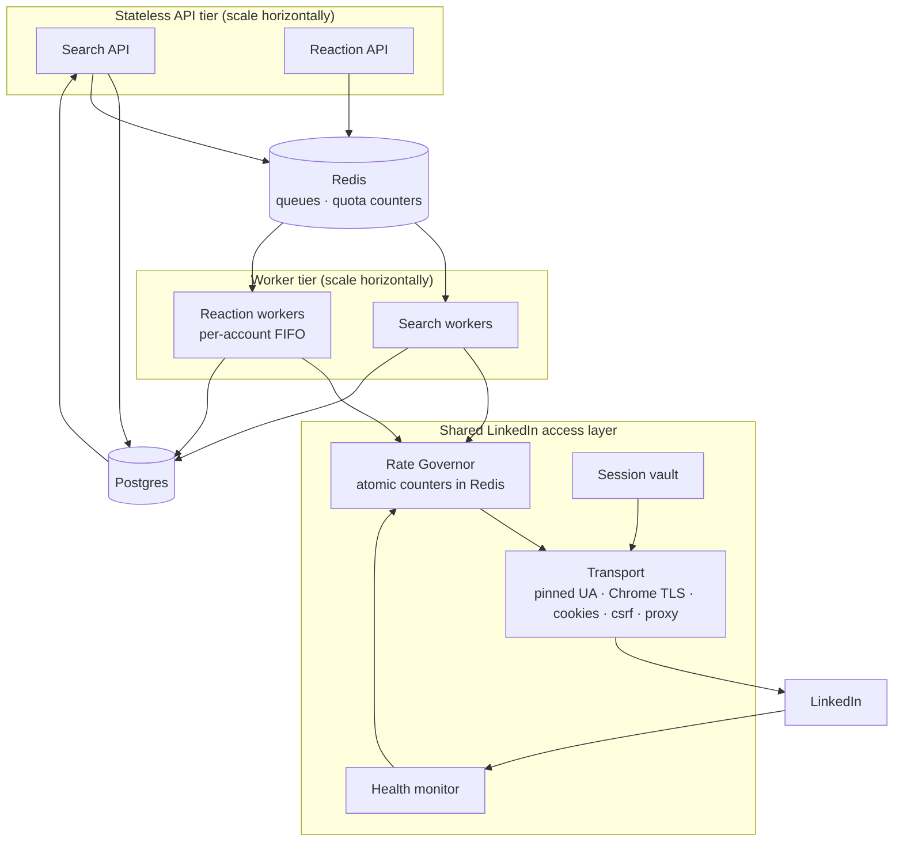

# Post Search API + Post Reaction API

**Two independent, horizontally scalable services** over a shared LinkedIn access layer.

Destination architecture: [PLAN.md](PLAN.md). This document specifies what gets built now — complete, not
reduced. Nothing here is a throwaway: the shared layer is the same one the full platform uses.

---

## 1. Scope

### Two services, genuinely independent

| Service | Operation | Depends on the other? |
|---|---|---|
| **Search API** | Keyword post search → posts | **No** |
| **Reaction API** | React / un-react to a post by URN | **No** |

**Independence is a hard requirement, not a nice-to-have:**
- The Reaction API takes a **post URN or LinkedIn post URL** as input. It does not require that post to
  have come from our search — the caller may source it from anywhere.
- The Search API never triggers reactions and holds no reaction state.
- They share the LinkedIn access layer (§4) and the account/session store — nothing else.
- Either can be deployed, scaled, rate-limited, versioned, or disabled **without touching the other.**
- Separate quota classes, separate workers, separate failure domains.

### Included
Multi-account · multi-tenant (orgs + scoped API keys) · proxy support · async action queue · webhooks ·
cursor pagination · idempotency · full audit log · live quota introspection · horizontal scaling.

---

## 2. Guards — what is real, and what I removed

Every control below is either **evidence-anchored** (traced to a documented finding) or **operator-chosen**
(a configurable default with no strong evidence — tune it against your own data). Nothing is presented as
a fact that isn't one.

### 2.1 Evidence-anchored controls — keep

| Control | What the evidence actually says |
|---|---|
| **Volume limits** | ">200 actions/day triggers alerts"; ~100 profiles/day soft ceiling; rate-limit challenge documented at ~900 requests/hour |
| **Randomized spacing** | "consistent patterns (like exactly 10 profiles every hour) look robotic" — regularity is itself the signal |
| **Chrome TLS (JA3) impersonation** | Node/Python default fingerprints "do not match any real Chrome release… blocked before any JavaScript runs"; LinkedIn "often detects that and invalidates `li_at`" |
| **Pinned user-agent** | Unipile: "strongly recommend collecting the user agent from the browser where the cookie is obtained **to prevent account disconnection**" |
| **Halt on challenge, never retry** | "recognizing these and pausing automation is the best way to avoid permanent restriction" |
| **Working-hours confinement** | "round-the-clock activity" named directly as a ban trigger |
| **Warm-up ramp for new accounts** | "14-day manual warm-up before any automation"; "slow ramp for fresh accounts" |
| **Sticky, geo-matched residential proxy** | Datacenter IPs and accounts sharing a /24 documented as a direct cause of restrictions |
| **`allow_redirects=False`** | The redirect to `/checkpoint/` **is** the detection signal; following it hides it |
| **Serving reads from our own store** | Architectural fact, not a behavioral guess — a call that never reaches LinkedIn carries no risk |

### 2.2 Removed — these were not guards

| Removed | Why |
|---|---|
| ~~"≤2 reactions per author per day"~~ | **I invented this.** No evidence LinkedIn scores per-author reaction density. Plausible-sounding, unfounded. |
| ~~"Weekend: 30% chance of zero activity, else 40%"~~ | Invented percentages. False precision on a real-but-vague idea. Folded into the generic working-hours config. |
| ~~Synthetic "human-mix" noise injection~~ | Extrapolated from one finding. Injecting fake feed views **makes extra LinkedIn calls to look safer** — it spends real risk to buy imagined safety. Worse than doing nothing. |
| ~~"~10% chance of a 2–5 min long pause"~~ | Arbitrary precision. Subsumed by randomized spacing, which is the actual evidence-backed control. |
| ~~Invented global daily ceiling (~90)~~ | I derived it by adding made-up class numbers. Replaced by a **configurable** ceiling anchored to the documented ~200/day alert threshold. |
| ~~"Resume at exactly 50%, re-ramp over 7 days"~~ | Magic numbers. Kept as *configurable* post-incident throttle; the mechanism is real, the numbers were not. |
| ~~"Free accounts get 40% of quotas"~~ | Invented ratio. Free-tier accounts do have tighter real limits, so `account_type` is recorded — but the multiplier is operator-set, not asserted. |

### 2.3 Design rule going forward
**All limits are configuration, not code.** Defaults ship conservative and are tunable per account and per
class. Where a default has no evidence behind it, the config comments say so.

### 2.4 Verified findings (tested, not assumed)

**Chrome TLS impersonation on Python 3.14 — ✅ works. My earlier "not 3.14" warning was wrong.**

Tested 2026-08-29 on Windows 11, CPython 3.14.4:

```
pip install curl_cffi        → curl_cffi 0.16.2
wheel selected               → curl_cffi-0.16.2-cp310-abi3-win_amd64.whl
```

The `cp310-abi3` tag is a **stable-ABI wheel**, forward-compatible with every CPython ≥ 3.10 including
3.14. The separate `cp314-cp314t` wheels in the release are for **free-threaded** builds only, which is
what I mistook for "no 3.14 support". No version pin is needed.

Impersonation verified against a TLS fingerprint service — and it demonstrably changes the fingerprint:

| Mode | JA4 |
|---|---|
| `impersonate="chrome124"` | `t13d1516h2_8daaf6152771_02713d6af862` |
| no impersonation (raw) | `t13d2712h2_b4f9224df7c1_cbb9361b6bf9` |

The raw fingerprint differs in cipher and extension counts (27/12 vs 15/16) — that raw value is the one
described as "not matching any real Chrome release". Impersonation is doing real work, not decoration.

⚠️ **One thing this surfaced:** with `impersonate="chrome124"`, `curl_cffi` sends its own default
User-Agent (a **macOS** Chrome UA). That would contradict the pinned-UA control in §2.1. **Transport must
always override the UA with the account's stored `user_agent`** — a macOS UA paired with a session born in
Windows Chrome is exactly the mismatch Unipile warns causes disconnection.

---

## 3. Architecture



**Invariants**
1. Every LinkedIn call goes through Transport; Transport is gated by the Governor. No bypass path exists.
2. `GET /posts` is served from Postgres — consumer read volume never reaches LinkedIn.
3. Reaction writes are queued and paced; they return `202`, never `200`.
4. `li_at` + `JSESSIONID` + originating `user-agent` + that account's proxy always travel together.
5. **Quota checks are atomic.** Under concurrency two workers must never both pass the same check — see §7.3.

---

## 4. Shared LinkedIn access layer

Used by both services; owned by neither.

| Component | Responsibility |
|---|---|
| **Session vault** | Encrypted `li_at`, `JSESSIONID`, pinned UA, proxy binding. `JSESSIONID` value **is** the `csrf-token` — kept in sync on every rotation |
| **Transport** | Single egress choke point. `curl_cffi` Chrome impersonation, `allow_redirects=False`, per-account proxy, request logging |
| **Rate Governor** | Atomic per-account × per-class counters (§7) |
| **Health monitor** | Response classification + circuit breaker (§8) |
| **Account service** | Connect, reconnect, checkpoint solve, status, quota introspection |

---

## 5. Stack

Built for scale from the start — no single-process assumptions to unwind later.

| Layer | Choice | Why |
|---|---|---|
| API | FastAPI + Pydantic | Stateless pods behind a load balancer; auto OpenAPI |
| Language | **Python 3.14** (3.10+ works) | ✅ Verified: `curl_cffi` 0.16.2 installs and impersonates on 3.14.4 via its `cp310-abi3` wheel (§2.4) |
| HTTP → LinkedIn | **`curl_cffi`** (`impersonate="chrome124"`) | Real Chrome JA3 |
| DB | **Postgres** + SQLAlchemy + Alembic | Multi-tenant, concurrent workers |
| Queue | **Redis + RQ** (or Celery) | **One queue per account** — preserves FIFO ordering, prevents cross-account contention |
| Counters | **Redis** (Lua check-and-increment) | Atomic quota under concurrency |
| Crypto | `cryptography` (Fernet) | Vault at rest |
| Logs | `structlog` JSON + redaction | Audit is a shipped feature |
| Tests | pytest + `freezegun` | Governor is time-dependent |
| Deploy | Docker Compose → K8s | API and worker tiers scale independently |

---

## 6. Data model

```sql
organizations(id PK, name, created_at, status)
api_keys(id PK, org_id FK, key_hash, label, scopes[], created_at, last_used_at, revoked_at)
          -- scopes: search:read, posts:read, reactions:write, accounts:*

accounts(id PK, org_id FK, linkedin_urn UNIQUE, label,
         account_type,          -- free | premium  (recorded; multiplier is operator-set)
         status,                -- healthy | checkpoint | needs_reconnect | paused | halted | banned
         timezone, connected_at, warmup_start,
         last_seen_at, last_success_at, halted_reason, halted_at)

sessions(account_id PK FK, li_at_enc, jsessionid_enc, user_agent, proxy_id FK NULL, rotated_at)

proxies(id PK, provider, host, port, username_enc, password_enc,
        country, region, assigned_account_id FK NULL, status, last_verified_at)

-- Limits are CONFIG, not constants in code
quota_config(account_id FK, op_class TEXT, daily_min INT, daily_max INT,
             hourly_max INT, spacing_min_s INT, spacing_max_s INT,
             window_start TIME, window_end TIME, enabled BOOL,
             PRIMARY KEY(account_id, op_class))

quota_state(account_id FK, day DATE, op_class TEXT,
            daily_target INT, used INT, used_hour INT, hour_bucket INT,
            next_allowed_at TIMESTAMP,
            PRIMARY KEY(account_id, day, op_class))

-- SEARCH SERVICE -------------------------------------------------------
posts(urn PK, author_name, author_urn, author_url, author_headline,
      text, posted_at, url, reactions_count, comments_count,
      raw_json, first_seen_at, last_seen_at)

searches(id PK, org_id FK, account_id FK, keyword, filters_json,
         interval_min NULL, enabled, last_run_at, next_run_at, created_at)
search_runs(id PK, search_id FK NULL, org_id FK, account_id FK,
            keyword, filters_json, status, ran_at, result_count, error)
search_results(run_id FK, post_urn FK, rank, PRIMARY KEY(run_id, post_urn))

-- REACTION SERVICE -----------------------------------------------------
reactions(id PK, org_id FK, account_id FK, post_urn, type,
          action_id FK, status, reacted_at,
          UNIQUE(account_id, post_urn))        -- cannot react twice; real constraint

-- SHARED ---------------------------------------------------------------
actions(id PK, org_id FK, account_id FK, service TEXT, op_class, operation,
        payload_json, status, scheduled_for, attempts, result_json, error,
        idempotency_key, created_at, completed_at,
        UNIQUE(org_id, idempotency_key))

webhooks(id PK, org_id FK, url, secret_enc, events[], enabled)
webhook_deliveries(id PK, webhook_id FK, event, payload_json, status_code,
                   attempts, next_retry_at, delivered_at, failed_permanently)

request_log(id PK, org_id FK, account_id FK, ts, service, op_class, operation,
            endpoint, method, status_code, latency_ms, outcome, signal,
            proxy_host, error)                 -- never stores cookie values

usage_daily(org_id FK, account_id FK, day DATE, op_class, count)
```

---

## 7. Rate Governor

### 7.1 Classes
Two, one per service — **separate budgets, no shared cap between services** (independence requirement).

| Class | Service | Default daily | Default hourly | Default spacing |
|---|---|---|---|---|
| `SEARCH` | Search API | 40–70 (randomized) | 10 | 20–60 s |
| `REACT` | Reaction API | 15–30 (randomized) | 5 | 60–180 s |

All values are `quota_config` rows — **per account, editable at runtime**. Defaults are conservative
starting points anchored to the documented ~200/day alert threshold and ~900/hour challenge threshold;
the exact splits are operator-chosen and should be tuned against your own audit data.

A **configurable account-wide daily ceiling** across both classes provides a backstop (default: 150,
below the documented >200/day alert threshold).

### 7.2 Behavior
- **Randomized daily target** within the configured band — never a fixed count, since regularity is the
  documented signal.
- **Randomized spacing** within the configured range on every action.
- **Working-hours window** in the account's timezone, with jittered boundaries.
- **Warm-up multiplier** for new accounts, ramping over a configurable period (default 14 days).
- **Post-incident throttle:** after a challenge, resume at a configurable fraction of prior targets and
  re-ramp. Mechanism is evidence-backed; the fraction is yours to set.

### 7.3 Atomicity — the real scaling problem
With many workers, a read-then-increment quota check races: two workers both read `used=49`, both pass a
limit of 50, both spend. **Check-and-increment must be a single atomic operation.**

```lua
-- Redis Lua, executed atomically
-- KEYS: daily, hourly, spacing   ARGV: daily_target, hourly_max, now, spacing_s
if tonumber(redis.call('GET', KEYS[1]) or 0) >= tonumber(ARGV[1]) then return {0,'daily'} end
if tonumber(redis.call('GET', KEYS[2]) or 0) >= tonumber(ARGV[2]) then return {0,'hourly'} end
local next_at = tonumber(redis.call('GET', KEYS[3]) or 0)
if tonumber(ARGV[3]) < next_at then return {0,'spacing',next_at} end
redis.call('INCR', KEYS[1]); redis.call('INCR', KEYS[2])
redis.call('SET', KEYS[3], tonumber(ARGV[3]) + tonumber(ARGV[4]))
return {1}
```
Postgres `quota_state` is the durable record, reconciled from Redis; Redis is the authority for live
decisions. Counters carry TTLs matching their window.

### 7.4 Outcomes
- `SEARCH` denied → **`429`** + `Retry-After` (callers expect search to return results synchronously)
- `REACT` denied → **`202`** + `scheduled_for` (the queue absorbs the wait; the caller never paces)

---

## 8. Health monitor & circuit breaker

| Signal | Severity | Action |
|---|---|---|
| HTTP 401 / 403 | 🔴 | Halt → `needs_reconnect`, webhook |
| HTTP 999 | 🔴 | Halt (configurable cooldown), alert |
| HTTP 429 | 🟠 | Backoff; reduce that class's target |
| Redirect → `/checkpoint/` | 🔴 | Halt → `checkpoint`, webhook |
| Redirect → `/authwall`, `/uas/login` | 🔴 | Session dead → `needs_reconnect` |
| CAPTCHA markers in body | 🔴 | Halt, alert |
| Empty results ×N consecutive | 🟡 | **Suspect route change, not a ban.** Alert; do not halt |

**Rules:** 🔴 halts the account, **cancels its queued actions**, emits `account.status_changed`, alerts.
**Never auto-retry a 🔴.** Distinguishing `200`-with-empty (endpoint changed) from non-`200` (we were
caught) matters — conflating them either halts healthy accounts or misses real restrictions.

---

## 9. Service A — Search API

Base `/v1` · `X-API-Key` · scope `search:read`, `posts:read`

### On-demand search
```http
POST /v1/search/posts
{ "account_id": "acc_...", "keyword": "AI agents",
  "filters": { "date_posted": "past_week", "sort_by": "recent",
               "author_urn": null, "content_type": null },
  "limit": 25 }

→ 200 { "data": { "run_id": "run_...", "posts": [Post], "count": 18 },
        "meta": { "quota": { "class": "SEARCH", "used": 19, "limit": 52 } } }

→ 429 { "error": "quota_exhausted", "retry_after": 1840,
        "next_available_at": "..." }              # Retry-After header set
→ 422 { "error": "account_not_healthy", "status": "needs_reconnect" }
```

### Async search (for large jobs)
```http
POST /v1/search/posts?mode=async   → 202 { "action_id": "act_...", "scheduled_for": "..." }
GET  /v1/search/runs/{run_id}      → { status, result_count, posts_cursor }
```

### Saved recurring searches
```http
POST   /v1/searches   { account_id, keyword, filters, interval_min }  → { id, next_run_at }
GET    /v1/searches   ?enabled=&cursor=
PATCH  /v1/searches/{id}   { enabled, interval_min, filters }
DELETE /v1/searches/{id}
GET    /v1/searches/{id}/results   ?since=&cursor=        # from store, free
```

### Stored posts — free, unlimited, never touches LinkedIn
```http
GET /v1/posts ?keyword=&author_urn=&since=&until=&q=&min_reactions=&limit=50&cursor=
→ { "data": [Post], "meta": { "next_cursor": "...", "total": 412 } }

GET /v1/posts/{urn}          → full post incl. raw payload
```

**`Post`**
```json
{ "urn": "urn:li:activity:7...", "url": "https://www.linkedin.com/feed/update/...",
  "author": { "name": "...", "urn": "...", "url": "...", "headline": "..." },
  "text": "...", "posted_at": "2026-08-28T09:14:00Z",
  "reactions_count": 42, "comments_count": 7,
  "first_seen_at": "...", "last_seen_at": "..." }
```

Posts are deduped by URN across every search and org-scoped on read.

---

## 10. Service B — Reaction API

Base `/v1` · `X-API-Key` · scope `reactions:write`
**Accepts any post URN or LinkedIn post URL — no dependency on the Search API.**

```http
POST /v1/reactions
Idempotency-Key: <uuid>
{ "account_id": "acc_...",
  "post": "urn:li:activity:7..."      // or "https://www.linkedin.com/feed/update/..."
  "type": "LIKE" }

→ 202 { "action_id": "act_...", "status": "scheduled",
        "scheduled_for": "2026-08-29T14:48:00Z",
        "quota": { "class": "REACT", "used": 4, "limit": 22 } }

→ 409 { "error": "already_reacted", "reaction_id": "rea_..." }   # UNIQUE(account, post)
→ 422 { "error": "account_not_healthy", "status": "checkpoint" }
```

**Types:** `LIKE` · `PRAISE` (celebrate) · `APPRECIATION` (support) · `EMPATHY` (love) ·
`INTEREST` (insightful) · `ENTERTAINMENT` (funny)

```http
DELETE /v1/reactions            { account_id, post }   → 202   # un-react
GET    /v1/reactions            ?account_id=&status=&since=&cursor=
GET    /v1/reactions/{id}
POST   /v1/reactions/bulk       { account_id, items: [{post, type}], ... }  → 202 { action_ids[] }
```

**Bulk** enqueues each item independently under the same quota — it is a convenience, not a bypass. Items
are paced exactly as individual calls; a 500-item bulk simply drains over days.

---

## 11. Shared endpoints

### Accounts
```http
POST  /v1/accounts/connect   { li_at, jsessionid, user_agent, timezone, label? }
GET   /v1/accounts           ?status=&cursor=
GET   /v1/accounts/{id}
PATCH /v1/accounts/{id}      { status: paused|healthy, timezone }
POST  /v1/accounts/{id}/checkpoint/solve   { code }
POST  /v1/accounts/{id}/reconnect
PATCH /v1/accounts/{id}/proxy              { proxy_id }
DELETE /v1/accounts/{id}
GET   /v1/accounts/{id}/limits
PUT   /v1/accounts/{id}/limits   { SEARCH: {...}, REACT: {...} }   # runtime tuning
```

### Actions, webhooks, system
```http
GET    /v1/actions/{id}   ·  GET /v1/actions?service=&status=&cursor=
DELETE /v1/actions/{id}                       # cancel while not running
POST   /v1/webhooks       { url, events[], secret }
GET    /v1/webhooks  ·  DELETE /v1/webhooks/{id}  ·  POST /v1/webhooks/{id}/redeliver
GET    /v1/health  ·  GET /v1/usage  ·  GET /v1/audit/requests
```

**Webhook events:** `search.completed` · `search.results` · `reaction.completed` · `reaction.failed` ·
`action.completed` · `action.failed` · `account.status_changed` · `account.checkpoint_required` ·
`quota.threshold`. HMAC-SHA256 signed, exponential retry, dead-letter, replayable.

---

## 12. Scaling

| Concern | Approach |
|---|---|
| API tier | Stateless pods behind LB; scale on RPS |
| Worker tier | Scale independently; **one Redis queue per account** preserves per-account FIFO while accounts run fully parallel |
| Quota races | Atomic Redis Lua check-and-increment (§7.3) |
| DB | Postgres + PgBouncer; indexes on `posts(first_seen_at)`, `posts(author_urn)`, `search_results(run_id)`, `actions(status, scheduled_for)`, `request_log(account_id, ts)` |
| Hot reads | `GET /posts` cacheable; full-text index on `posts.text` |
| Throughput ceiling | **Bounded by connected accounts, not infrastructure.** Per-account limits are fixed by safety, so capacity scales with account count — this is the fundamental unit of scale and should drive pricing |
| Log growth | Partition `request_log` by month; retention policy |
| Proxy pool | One sticky geo-matched residential IP per account; verify ASN and geo at assignment |
| Multi-region | Workers can be pinned near their accounts' proxies to reduce latency and geo mismatch |

---

## 13. Phased delivery

### Phase 0 — Spikes ⚠️ blocking (1–2 days)
| # | Spike | Gate |
|---|---|---|
| **0.1** | **Post search route.** Does Voyager content search return data, or is the rendered page required? Research indicates it may return `200` with empty `included[]` | Working request shape + fixture |
| **0.2** | **Reaction endpoint.** Capture the real request: URN format, csrf header, payload, type enum | Working request shape + fixture |
| ~~**0.3**~~ | ~~**Chrome TLS**~~ ✅ **DONE** — verified on Python 3.14.4 | Chrome JA4 confirmed (§2.4) |

🔴 **0.1 is make-or-break for Service A.** Because the services are independent, **Service B can ship even
if 0.1 fails** — that independence is worth real money here, not just architectural tidiness.

### Phase 1 — Shared layer
Orgs, API keys, scoping · vault · Transport · Governor (atomic counters) · health/breaker · account
endpoints · audit log · extension connect · Postgres + Redis + workers + Docker Compose.

### Phase 2 — Service A (Search)
`search_posts` adapter (+ mock) · post store + dedupe · on-demand, async, and saved searches ·
`GET /posts` · search webhooks.

### Phase 3 — Service B (Reactions)
`reactions` adapter · action queue (idempotency, cancellation, per-account FIFO) · react / un-react /
bulk / list · reaction webhooks.

*Phases 2 and 3 are independent and can run in parallel or in either order.*

### Phase 4 — Soak & harden
Both services at low volume on real accounts, 14+ days. Tune `quota_config` from **your own audit data**
rather than the shipped defaults. Failure drills: expire cookie, inject checkpoint, force 999, kill a
worker mid-action, race two workers on one account's last quota unit.

### Phase 5 — Scale out
Per-account proxies · multi-worker/multi-region · Postgres tuning · log partitioning · dashboard · SDKs.

---

## 14. Open decisions

- [x] ~~Scope~~ → **two independent services: post search, post reactions**
- [x] ~~Guards~~ → **evidence-anchored only; everything else is tunable config** (§2)
- [ ] **Which search route works** → Phase 0.1 (Service B unaffected)
- [ ] Proxy vendor + cost per account (sets the pricing floor)
- [ ] Default `quota_config` values — ship conservative, tune from audit data
- [ ] Whose accounts absorb soak risk in Phase 4
- [ ] Sync search cap: max `limit` per call, and pagination depth
