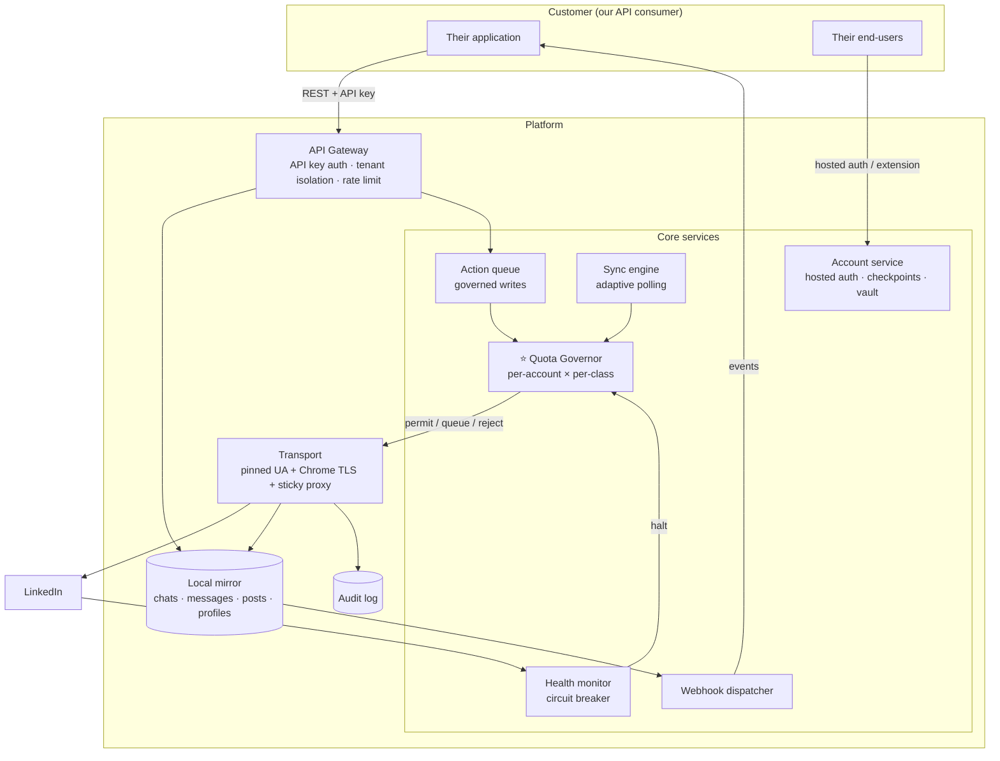

# LinkedIn API Platform — Full Implementation Plan

**A Unipile alternative, LinkedIn-only, with safety enforced by the platform.**

> 📍 **This is the destination.** What is being built right now is the two-operation slice in
> **[MVP.md](MVP.md)** — post search + post reaction. That slice uses the same Transport, Governor,
> health monitor and audit log specced here, so it grows into this plan rather than being replaced.

---

## 0. Strategy — where the wedge is

Unipile is **500+ endpoints across LinkedIn, WhatsApp, Instagram, Telegram, email and calendar**.
Matching that surface is not winnable. The opening is in *how* they do LinkedIn, not *how much*:

| Unipile weakness (documented) | Our position |
|---|---|
| *"Constructs reverse-engineered wire-level calls and **leaves pacing to your application**"* | **Pacing is enforced by the platform.** Impossible to exceed safe limits through our API. |
| Reviewers: *"missing request logs made it hard to diagnose why accounts were getting disconnected"* | **Full per-request audit trail**, exposed via API from day one. |
| No published restriction/disconnection statistics; no behavioral limits | **Live quota endpoint** — customers see exactly what's left before they spend it. |
| Multi-channel breadth, shallow LinkedIn safety | **LinkedIn-only, deep.** Safety is the product. |
| Billed on *peak* connected accounts in a 30-day window (test batches spike the bill) | Transparent per-active-account billing. |

**Positioning:** *"The LinkedIn API that won't get your users banned."*
Our real competitor is **Linked API** (already does real-browser + platform-enforced pacing), not Unipile.

**The core product thesis:** a rate-limited, audited, multi-tenant LinkedIn API where **writes are queued
and paced by us**, not fired blindly on the caller's behalf.

**Risk statement:** this violates LinkedIn User Agreement §8.2. No architecture makes restriction risk
zero. Every design decision below optimizes for *the connected account surviving*, because a banned
end-user account is a churned customer.

---

## Table of contents

1. [Product scope & operation ladder](#1-product-scope--operation-ladder)
2. [Architecture](#2-architecture)
3. [Multi-tenancy model](#3-multi-tenancy-model)
4. [Tech stack](#4-tech-stack)
5. [Repository layout](#5-repository-layout)
6. [Data model](#6-data-model)
7. [Account connection & checkpoints](#7-account-connection--checkpoints)
8. [The Quota Governor](#8-the-quota-governor-) ⭐
9. [Sync engine & the local mirror](#9-sync-engine--the-local-mirror)
10. [Async write actions](#10-async-write-actions)
11. [Webhooks](#11-webhooks)
12. [Full API specification](#12-full-api-specification)
13. [Health monitor & circuit breaker](#13-health-monitor--circuit-breaker)
14. [Proxy strategy](#14-proxy-strategy)
15. [Security](#15-security)
16. [Observability & audit](#16-observability--audit)
17. [Testing strategy](#17-testing-strategy)
18. [Phased delivery](#18-phased-delivery)
19. [Operations runbook](#19-operations-runbook)
20. [Risk register](#20-risk-register)
21. [Open decisions](#21-open-decisions)

---

## 1. Product scope & operation ladder

Every LinkedIn operation is classified by **risk class**, which determines its quota, its pacing, and
which phase it ships in. **This classification is the backbone of the entire product.**

| Class | Operations | Daily limit (paid acct) | Risk | Phase |
|---|---|---|---|---|
| `READ_MIRROR` | list chats, list messages, list stored posts — **served from local mirror** | ∞ (no LinkedIn call) | none | 1 |
| `READ_LIGHT` | own profile, relations, followers, invitation lists | ~100 | 🟢 low | 1 |
| `READ_PROFILE` | **get profile by id** — ⚠️ counts as a *profile view* on LinkedIn | **80–100** | 🟠 med | 1 |
| `READ_COMPANY` | company profile | ~100 | 🟢 low | 1 |
| `SEARCH` | people / company / **post** / job search | **~50–70** | 🟠 med | 1 |
| `SYNC` | incremental chat & message polling | governed, adaptive | 🟢 low | 3 |
| `WRITE_MESSAGE` | send message, reply | **30–60** | 🔴 high | 4 |
| `WRITE_INVITE` | send connection invitation | **20–25 rec. / 80 hard cap / ~200 wk** | 🔴 highest | 4 |
| `WRITE_ENGAGE` | comment, react | **5–15** ⚠️ | 🔴 high | 4 |
| `WRITE_POST` | publish post | **1–3** | 🟠 med | 4 |
| `INMAIL` | send InMail | credit-limited | 🟠 med | 4 |

⚠️ **`WRITE_ENGAGE` carries a specific warning from the research:** practitioners advise *never* automating
comments and likes on third-party posts. We ship it because competitors do, but with the tightest
default quota and a documented warning in the API docs.

**Deliberately out of scope (v1):** WhatsApp, Instagram, Telegram, email, calendar. LinkedIn Recruiter and
Sales Navigator are Phase 5 — they need separate contract/seat handling.

---

## 2. Architecture



**Four invariants that must never be violated:**

1. **Reads are served from the mirror; LinkedIn is never in the customer's request path.** A customer
   polling `GET /chats` hits Postgres. Their traffic volume is structurally decoupled from LinkedIn's.
2. **Every LinkedIn call passes Transport, and Transport is gated by the Governor.** No bypass exists.
3. **Writes are queued, never synchronous.** `202 Accepted` + an action resource. This is the product
   differentiator expressed directly in the API contract.
4. **The identity triple + proxy travel together, always** — `li_at` + `JSESSIONID` + the exact
   originating `user-agent` + that account's pinned sticky proxy. A UA mismatch alone drops the session.

---

## 3. Multi-tenancy model

```
Organization (our paying customer)
 └── API keys (scoped, revocable)
 └── Accounts (their end-users' connected LinkedIn accounts)
      └── Sessions (encrypted vault: cookies + UA + proxy)
      └── Quota state (per operation class)
      └── Mirror data (chats, messages, posts, profiles)
      └── Audit log
```

- **Isolation is enforced at the query layer**, not in handlers: every query is scoped by `org_id` via a
  mandatory dependency. A missing scope must be a test failure, not a runtime bug.
- **Accounts belong to an org.** One LinkedIn account may not be connected to two orgs simultaneously
  (two systems pacing one account independently = guaranteed ban).
- **API keys** are scoped: `accounts:read`, `accounts:write`, `messaging:read`, `messaging:write`,
  `search`, `webhooks`.
- **Billing metric:** *active* connected accounts per month — deliberately not Unipile's "peak in a
  30-day window", which their reviewers flag as a gotcha where a test batch sets the whole month's bill.

---

## 4. Tech stack

| Layer | Choice | Rationale |
|---|---|---|
| API | **FastAPI + Pydantic** | Typed contracts, auto OpenAPI — the docs *are* the product for an API company |
| Language | **Python 3.14** (3.10+ works) | ✅ Verified: `curl_cffi` 0.16.2 installs and impersonates correctly on 3.14.4 via its `cp310-abi3` wheel |
| HTTP to LinkedIn | **`curl_cffi` (`impersonate="chrome124"`)** | Real Chrome JA3. Plain `requests` is detected before any JS runs |
| Headless browser | **Playwright** (only where required) | Some routes need rendering; isolated behind adapters |
| DB | **Postgres** from day one | Multi-tenant; SQLite would need replacing immediately |
| Queue | **Redis + RQ (or Celery)** | Per-account queues; write actions; sync jobs |
| Cache | **Redis** | Quota counters, dedupe, hot mirror reads |
| Crypto | **`cryptography`** (Fernet) | Vault encryption at rest |
| Logging | **`structlog`** JSON | Audit trail is a shipped feature (§16) |
| Migrations | **Alembic** | Non-negotiable for a multi-tenant schema |
| Tests | **pytest + `freezegun`** | Governor is time-dependent; must be time-mocked |
| Extension | **MV3 vanilla JS** | Optional safest connect path |

---

## 5. Repository layout

```
linkedIn-automation/
├── PLAN.md · README.md · .env.example · .gitignore
├── docker-compose.yml              # postgres + redis for local dev
│
├── extension/                      # optional safest connect path
│   ├── manifest.json · popup.html · popup.js · background.js
│
└── backend/
    ├── pyproject.toml · alembic.ini · migrations/
    └── app/
        ├── main.py · config.py · db.py · models.py · schemas.py · crypto.py
        │
        ├── api/v1/
        │   ├── deps.py             # ⭐ api-key auth + MANDATORY org scoping
        │   ├── accounts.py         # connect, hosted auth, checkpoints, limits
        │   ├── users.py            # profiles, relations, followers
        │   ├── companies.py
        │   ├── search.py           # people / companies / posts / jobs
        │   ├── posts.py            # read + comment/react/create
        │   ├── chats.py            # chats, messages, attendees
        │   ├── invitations.py
        │   ├── actions.py          # async write status
        │   ├── webhooks.py
        │   └── system.py           # health, usage, audit
        │
        ├── linkedin/
        │   ├── transport.py        # ⭐ choke point: UA + TLS + cookies + csrf + proxy
        │   ├── governor.py         # ⭐ per-account × per-class quota (§8)
        │   ├── health.py           # detection + circuit breaker (§13)
        │   ├── session.py          # vault, csrf derivation, rotation
        │   ├── checkpoints.py      # 2FA/OTP/CAPTCHA/IN_APP flows
        │   └── adapters/
        │       ├── base.py · mock.py
        │       ├── profiles.py · companies.py · search.py
        │       ├── posts.py · messaging.py · invitations.py
        │
        ├── sync/
        │   ├── engine.py           # adaptive polling scheduler
        │   ├── chats.py · messages.py · invitations.py
        │
        ├── actions/
        │   ├── queue.py            # governed write execution
        │   └── handlers/           # one per write op
        │
        ├── webhooks/
        │   ├── dispatcher.py       # HMAC signing, retry w/ backoff, DLQ
        │
        └── obs/
            ├── logging.py          # structlog + secret redaction
            └── alerts.py
    └── tests/
```

---

## 6. Data model

```sql
organizations(id PK, name, plan, created_at, status)

api_keys(id PK, org_id FK, key_hash, label, scopes[], created_at, last_used_at, revoked_at)

accounts(
  id PK, org_id FK,
  provider            TEXT,           -- 'linkedin' (future-proofed)
  linkedin_urn        TEXT UNIQUE,    -- prevents double-connection across orgs
  name, headline, picture_url,
  account_type        TEXT,           -- free | premium | sales_nav | recruiter
  status              TEXT,           -- connecting | healthy | checkpoint | needs_reconnect
                                      -- | paused | halted | banned
  timezone            TEXT,           -- drives working hours
  connected_at, warmup_start, last_seen_at, last_success_at,
  halted_reason, halted_at
)

sessions(                              -- encrypted vault, 1:1 with accounts
  account_id PK FK,
  li_at_enc BLOB, jsessionid_enc BLOB,
  user_agent TEXT,                     -- pinned; must match origin browser exactly
  proxy_id FK NULL, rotated_at
)

proxies(id PK, provider, host, port, username_enc, password_enc,
        country, region, assigned_account_id FK NULL, status, last_verified_at)

quota_state(                           -- ⭐ per account × per class × per day
  account_id FK, day DATE, op_class TEXT,
  daily_target INT,                    -- randomized within class band
  used INT, hour_bucket INT, used_hour INT,
  window_start TIME, window_end TIME,  -- jittered working hours
  next_allowed_at TIMESTAMP,
  PRIMARY KEY (account_id, day, op_class)
)

-- MIRROR ---------------------------------------------------------------
chats(id PK, account_id FK, provider_id, type, name, unread_count,
      last_message_at, synced_at)
messages(id PK, chat_id FK, account_id FK, provider_id, sender_urn,
         text, attachments_json, sent_at, direction, seen, raw_json)
attendees(id PK, account_id FK, provider_urn, name, headline, picture_url, is_self)
profiles(urn PK, name, headline, location, summary, current_company,
         raw_json, fetched_at, fetched_by_account FK)
companies(urn PK, name, industry, size, website, raw_json, fetched_at)
posts(urn PK, author_urn, author_name, text, posted_at, url,
      reactions, comments_count, raw_json, first_seen_at)
post_comments(id PK, post_urn FK, author_urn, text, commented_at)
invitations(id PK, account_id FK, provider_id, direction, target_urn,
            message, status, sent_at, responded_at)
relations(account_id FK, target_urn, connected_at, PRIMARY KEY(account_id,target_urn))

searches(id PK, org_id FK, account_id FK, type, query, filters_json,
         interval_min, enabled, last_run_at, next_run_at)
search_results(search_id FK, result_urn, result_type, fetched_at, rank,
               PRIMARY KEY(search_id, result_urn))

-- WRITES ---------------------------------------------------------------
actions(                               -- every queued write
  id PK, org_id FK, account_id FK,
  op_class TEXT, operation TEXT,
  payload_json TEXT,
  status TEXT,                         -- queued | scheduled | running | succeeded
                                       -- | failed | rejected | cancelled
  scheduled_for TIMESTAMP,             -- governor-assigned execution time
  attempts INT, result_json, error, created_at, completed_at
)

-- INFRA ----------------------------------------------------------------
webhooks(id PK, org_id FK, url, secret_enc, events[], enabled, created_at)
webhook_deliveries(id PK, webhook_id FK, event, payload_json, status_code,
                   attempts, next_retry_at, delivered_at, failed_permanently BOOL)

request_log(                           -- ⭐ shipped feature, not just ops
  id PK, org_id FK, account_id FK, ts,
  op_class, operation, endpoint, method,
  status_code, latency_ms,
  outcome TEXT,                        -- ok | challenge | auth_fail | rate_limit | error
  signal TEXT NULL, proxy_host TEXT NULL, error TEXT NULL
  -- NEVER store cookie values
)

usage_daily(org_id FK, account_id FK, day DATE, op_class, count)
```

---

## 7. Account connection & checkpoints

### 7.1 Three connect paths

| Path | Flow | Safety | Use when |
|---|---|---|---|
| **A. Extension** ⭐ safest | End-user installs MV3 extension → reads `li_at`+`JSESSIONID`+UA locally → posts to us | **Best.** No login from our IP; UA captured natively; invisible to LinkedIn (no DOM injection) | Customer can ask users to install |
| **B. Hosted auth wizard** | We generate a temp link → user logs into LinkedIn on our hosted page → we capture session | Convenient, **but login originates from our infra → far more likely to trigger checkpoints** | Zero-install requirement (Unipile parity) |
| **C. Cookie paste** | User pastes `li_at` + UA manually | Works; poor UX | Locked-down orgs, fallback |

All three converge on the same vault record. **Path A is the recommended default and a genuine safety
advantage over Unipile**, whose hosted flow is documented to trigger LinkedIn warnings and force
reconnection each time the popup appears.

### 7.2 Checkpoint handling (Unipile parity, required)

LinkedIn interrupts logins with challenges. Surface them to the customer rather than failing:

```
POST /v1/accounts/connect  →  202 Accepted
{ "account_id": "...", "status": "checkpoint",
  "checkpoint": { "type": "2FA", "expires_at": "...", "hint": "***4821" } }

POST /v1/accounts/{id}/checkpoint/solve   { "code": "123456" }
  → 200 { status: "healthy" }  |  202 { checkpoint: {...} }  (chained challenge)
```

Types: `2FA` · `OTP` · `IN_APP_VALIDATION` · `CAPTCHA` · `PHONE_REGISTER`.
Intent window: **5 minutes** (match Unipile). `IN_APP_VALIDATION` supports `{"code":"TRY_ANOTHER_WAY"}`
to fall back to code-based verification. `CAPTCHA` cannot be solved by us — surface to the end-user.

### 7.3 Session lifetime
- **Extension re-push:** `chrome.alarms` hourly re-read; LinkedIn refreshes `li_at` during normal
  browsing, keeping sessions alive with **zero user effort and no browser-open requirement.**
- `JSESSIONID` rotates faster than `li_at` and its value **is** the `csrf-token` — always keep in sync.
- On expiry: `needs_reconnect` + `account.status_changed` webhook. Never auto-retry.

---

## 8. The Quota Governor ⭐

**The product.** Unipile *"leaves pacing to your application"*; we make exceeding safe limits
structurally impossible. Quotas are **per account × per operation class × per day**.

### 8.1 Class quotas

| Class | Daily band | Hourly | Min spacing | Notes |
|---|---|---|---|---|
| `READ_MIRROR` | ∞ | ∞ | — | Never touches LinkedIn |
| `READ_LIGHT` | 60–100 | 15 | 8–25s | |
| `READ_PROFILE` | **50–80** | 10 | 15–40s | ⚠️ each = a profile view |
| `READ_COMPANY` | 50–80 | 12 | 10–30s | |
| `SEARCH` | **40–70** | 10 | 20–60s | |
| `SYNC` | adaptive | 12 | 5–15 min | §9 |
| `WRITE_MESSAGE` | **25–50** | 6 | 60–180s | |
| `WRITE_INVITE` | **15–25** | 4 | 120–300s | Weekly cap **~200** also enforced |
| `WRITE_ENGAGE` | **5–15** | 3 | 180–600s | ⚠️ highest-warning class |
| `WRITE_POST` | **1–3** | 1 | 4h | |
| `INMAIL` | credit-bound | 3 | 300s | Track balance |

Additionally: a **global daily ceiling of ~150 LinkedIn-touching actions** across *all* classes
(research: >200 actions/day triggers alerts), and an **hourly ceiling far below the documented ~900/hr
challenge threshold.**

### 8.2 Warm-up ramp (all classes scale by this multiplier)
| Days since connect | Multiplier |
|---|---|
| 1–3 | 0.10 |
| 4–7 | 0.25 |
| 8–14 | 0.50 |
| 15+ | 1.00 |

### 8.3 Behavioral rules
- **Randomize daily targets** within each band — never the same count two days running.
- **Randomized spacing** per class + ~10% chance of a 2–5 min long pause.
- **Working hours only**, in the *account's* timezone, with jittered start/end. Nothing overnight.
- **Weekend:** 30% chance zero, else 40% of weekday target.
- **Human-mix ratio:** never let an account be ~100% one class. Research finding: *scrape-only accounts
  get flagged.* Track class distribution; interleave `READ_LIGHT` "noise" when a customer's usage is
  monotone, and expose the ratio on `/limits`.
- **Free-account detection:** free LinkedIn accounts have far tighter real limits (~5 invites/month vs
  80–100/day paid). Detect `account_type` at connect and scale quotas accordingly.

### 8.4 Algorithm
```python
def evaluate(account, op_class) -> Decision:
    if account.status != "healthy":         return REJECT(account.status)
    q  = quota_for_today(account, op_class) # created w/ randomized target × warmup mult
    g  = global_state(account)
    now = now_in(account.timezone)

    if not in_window(now, q):               return SCHEDULE(next_window_open(account))
    if g.used_today >= GLOBAL_DAILY_CEILING:return SCHEDULE(tomorrow_window(account))
    if q.used  >= q.daily_target:           return SCHEDULE(tomorrow_window(account))
    if q.used_hour >= CLASS_HOURLY[op_class]: return SCHEDULE(next_hour())
    if op_class == "WRITE_INVITE" and weekly_invites(account) >= 200:
                                            return SCHEDULE(next_week())
    if now < q.next_allowed_at:             return SCHEDULE(q.next_allowed_at)
    return PERMIT

def record(account, op_class):
    lo, hi = CLASS_SPACING[op_class]
    delay  = uniform(lo, hi)
    if random() < 0.10: delay += uniform(120, 300)
    q.next_allowed_at = now() + delay
    q.used += 1; q.used_hour += 1; global.used_today += 1
```

**`SCHEDULE` is the key return value:** reads raise `429` with `Retry-After`; **writes are accepted
(`202`) and queued for `scheduled_for`.** The customer never has to implement pacing — that is the
entire pitch.

### 8.5 Live quota exposure — a differentiator nobody ships cleanly
```
GET /v1/accounts/{id}/limits
{ "global": { "used": 47, "ceiling": 150, "resets_at": "..." },
  "classes": {
    "SEARCH":       { "used": 12, "limit": 58, "next_available_at": "...", "window": "09:12–18:47" },
    "WRITE_INVITE": { "used": 8,  "limit": 21, "weekly_used": 63, "weekly_limit": 200 }
  },
  "warmup": { "day": 6, "multiplier": 0.25 },
  "health": { "status": "healthy", "last_challenge_at": null, "class_mix_ok": true } }
```

---

## 9. Sync engine & the local mirror

Customers expect an inbox. LinkedIn has no push, so **we poll — and polling consumes quota**. Making
that cheap is the central engineering problem of Phase 3.

**Adaptive polling:**
| Account state | Chat-list poll interval |
|---|---|
| Active conversation < 15 min ago | 5 min |
| Activity today | 15 min |
| Quiet 1–3 days | 30 min |
| Dormant > 7 days | 2 h |
| Outside working hours | paused |

- Poll the **chat list only** (cheap); fetch message bodies **only for chats whose
  `last_message_at` advanced.**
- **Backfill on connect:** N most recent chats, throttled over hours/days — never a burst. Expose
  progress as `sync_status: backfilling | live`.
- Delta detection → write to mirror → emit `message.received`.
- Sync competes for the same global ceiling as customer-triggered reads; `SYNC` yields to interactive
  classes under pressure.

**Payoff:** `GET /chats` and `GET /messages` are `READ_MIRROR` — unlimited, fast, zero LinkedIn risk.

---

## 10. Async write actions

Writes cannot be synchronous — the Governor may need to defer them by hours.

```
POST /v1/chats/{id}/messages   { "text": "..." }
202 Accepted
{ "action_id": "act_...", "status": "scheduled",
  "scheduled_for": "2026-08-29T14:23:11Z",
  "quota": { "class": "WRITE_MESSAGE", "used": 12, "limit": 38 } }
```

- `GET /v1/actions/{id}` → `queued | scheduled | running | succeeded | failed | rejected | cancelled`
- `DELETE /v1/actions/{id}` cancels while not yet running
- Webhooks: `action.completed` / `action.failed`
- **Rejected immediately (not queued)** when the request can never be satisfied: account halted, weekly
  invite cap exhausted, InMail credits at zero. Fail fast rather than queue forever.
- Idempotency: `Idempotency-Key` header, deduped per org for 24h — retries must never double-send.
- **Ordering:** per-account FIFO within a class, so a customer's message sequence stays in order.

**Documentation must be blunt about this.** "Your message will be sent within the next few hours" is a
worse DX than Unipile's instant send — and a far better outcome than a banned account. Sell it as the
feature it is.

---

## 11. Webhooks

```
POST /v1/webhooks  { url, events: [...], secret? }
```

| Event | Fires when |
|---|---|
| `message.received` | Sync finds an inbound message |
| `message.sent` | Queued send succeeded |
| `chat.created` | New conversation appears |
| `invitation.received` | New inbound connection request |
| `invitation.accepted` | A sent invite was accepted |
| `relation.created` | New connection |
| `account.status_changed` | healthy ⇄ needs_reconnect / halted / banned |
| `account.checkpoint_required` | ⚠️ Customer must prompt their user |
| `action.completed` / `action.failed` | Async write resolved |
| `search.results` | Scheduled search found new items |
| `quota.threshold` | Account crossed 80% of a class quota |

**Delivery:** HMAC-SHA256 signature (`X-Signature`, `X-Timestamp`) over the raw body; exponential retry
(1m, 5m, 30m, 2h, 12h) then dead-letter; replayable via `POST /v1/webhooks/{id}/redeliver`.
`quota.threshold` and `account.checkpoint_required` are the two events that make the safety model
*visible* to customers — they matter more than they look.

---

## 12. Full API specification

Base `/v1`. Auth `X-API-Key`. All responses envelope `{ data, meta }`; cursor pagination.

### Accounts
```
POST   /accounts/hosted-auth          → { url, expires_at }        # path B
POST   /accounts/connect              { li_at, jsessionid, user_agent, timezone }  # paths A/C
GET    /accounts                      ?status=&cursor=
GET    /accounts/{id}
DELETE /accounts/{id}
POST   /accounts/{id}/reconnect
POST   /accounts/{id}/checkpoint/solve  { code }
POST   /accounts/{id}/checkpoint/resend
GET    /accounts/{id}/limits          ⭐ live quota (§8.5)
PATCH  /accounts/{id}                 { status: paused|healthy, timezone }
PATCH  /accounts/{id}/proxy           { proxy_id }
POST   /accounts/{id}/resync          # force mirror resync
```

### Users & profiles
```
GET /accounts/{id}/me
GET /users/{identifier}               ?account_id=   # ⚠️ READ_PROFILE — a profile view
GET /users/{identifier}/posts
GET /companies/{identifier}
GET /relations                        ?account_id=&cursor=
GET /followers  ·  GET /following
```

### Search
```
POST /search/people      { account_id, query, filters, limit }
POST /search/companies
POST /search/posts       ⭐ keyword post discovery
POST /search/jobs
GET  /search/parameters  ?type=   # available filters / typeahead
POST /searches           { type, query, filters, interval_min }   # saved recurring
GET  /searches  ·  PATCH /searches/{id}  ·  DELETE /searches/{id}
GET  /searches/{id}/results  ?since=&cursor=      # READ_MIRROR
```

### Posts
```
GET  /posts/{urn}
GET  /posts/{urn}/comments  ·  GET /posts/{urn}/reactions
POST /posts                  { account_id, text, media? }        [202]
POST /posts/{urn}/comments   { account_id, text }                [202] ⚠️
POST /posts/{urn}/reactions  { account_id, type }                [202] ⚠️
```

### Messaging
```
GET   /chats                 ?account_id=&unread=&cursor=        # READ_MIRROR
GET   /chats/{id}
GET   /chats/{id}/messages   ?since=&cursor=                     # READ_MIRROR
POST  /chats                 { account_id, attendee_urn, text }  [202]
POST  /chats/{id}/messages   { text, attachments? }              [202]
PATCH /chats/{id}            { read: true, muted: true }
GET   /messages/{id}  ·  GET /messages/{id}/attachments/{aid}
GET   /attendees      ·  GET /attendees/{id}
```

### Invitations
```
POST   /invitations          { account_id, target_urn, message? } [202] ⚠️ highest risk
GET    /invitations          ?direction=sent|received&status=
DELETE /invitations/{id}                                          [202]
POST   /invitations/{id}/accept  ·  /decline                      [202]
```

### Actions, webhooks, system
```
GET    /actions/{id}  ·  GET /actions?status=&account_id=  ·  DELETE /actions/{id}
POST   /webhooks  ·  GET /webhooks  ·  DELETE /webhooks/{id}
POST   /webhooks/{id}/redeliver
GET    /health
GET    /usage        ?from=&to=&account_id=      # billing-grade counters
GET    /audit/requests ?account_id=&outcome=&from=   ⭐ the log Unipile lacks
```

**Error contract**
| Code | Meaning |
|---|---|
| `400` | Invalid request |
| `401` | Bad/missing API key · `403` scope denied |
| `404` | Not found / not in your org |
| `409` | Account already connected elsewhere; idempotency conflict |
| `422` | Account not `healthy` (`checkpoint`, `needs_reconnect`, `halted`) |
| `429` | Quota exhausted for a **read** — includes `Retry-After` + quota body |
| `503` | Provider unreachable |

---

## 13. Health monitor & circuit breaker

| Signal | Severity | Action |
|---|---|---|
| HTTP 401 / 403 | 🔴 | Halt → `needs_reconnect`, webhook |
| HTTP 999 (LinkedIn rate-limit) | 🔴 | Halt 24h, alert |
| HTTP 429 | 🟠 | Backoff; halve that class's daily target |
| Redirect → `/checkpoint/` | 🔴 | Halt → `checkpoint`, `account.checkpoint_required` webhook |
| Redirect → `/authwall` or `/uas/login` | 🔴 | Session dead → `needs_reconnect` |
| CAPTCHA markers in body | 🔴 | Halt, alert |
| Empty results ×3 consecutive | 🟡 | **Suspect route death, not ban.** Investigate before halting |
| Latency > 3× baseline | 🟡 | Log, watch |

**Rules:**
1. 🔴 → set status, **cancel that account's queued actions**, emit webhook, alert.
2. **Never auto-retry a 🔴.** Retrying through a soft warning is what turns it into a permanent ban.
3. Resume after a challenge at **50% of previous targets**, re-ramping over 7 days.
4. `Transport` uses `allow_redirects=False` — the redirect **is** the signal; following it hides it.
5. Distinguish "LinkedIn changed the endpoint" (200-with-empty) from "we got caught" (non-200). These
   demand opposite responses; conflating them either halts healthy accounts or misses real bans.

---

## 14. Proxy strategy

Mandatory from the moment we host other people's accounts.

- **One dedicated, sticky, geo-matched residential/mobile IP per account.** Never datacenter, never a
  shared /24 — testing found HeyReach and Dripify assigning datacenter IPs with accounts in the same /24,
  which is exactly what gets cloud users banned.
- Match the country/region the account's LinkedIn profile is registered to.
- **Verify at assignment**: ASN is residential, not previously flagged, and geo actually matches.
- Re-verify periodically; alert on drift. Never rotate an account's IP casually — a stable IP is the
  signal we want; rotation looks like account takeover.
- Support **bring-your-own-proxy** per account (Unipile parity, and a genuine enterprise ask).
- Vendors: Bright Data / IPRoyal / Smartproxy sticky sessions. **Cost model this early** — at scale it is
  the dominant infrastructure line item and directly sets the price floor per connected account.

---

## 15. Security

| Concern | Control |
|---|---|
| Cookies at rest | Fernet-encrypted; per-deployment `VAULT_KEY` from env |
| Cookies in logs | **Never.** Redaction filter; log an 8-char hash prefix only |
| Cookies in transit | HTTPS mandatory everywhere except local dev |
| Passwords | **Never stored, never logged.** Hosted auth submits directly to LinkedIn; extension path never sees one |
| API keys | argon2/bcrypt hashed; shown once; scoped; revocable |
| Webhook payloads | HMAC-SHA256 signed; customer-supplied secret encrypted |
| Tenant isolation | `org_id` scoping enforced in a shared query dependency; **tested explicitly** |
| Proxy credentials | Encrypted; only host logged |
| PII | Mirror holds real people's profile/message data → **GDPR applies**: retention windows, `DELETE /accounts/{id}` purges mirror data, DPA with customers |
| Blast radius | Vault key rotation re-encrypts all sessions in one migration |

---

## 16. Observability & audit

This is a **shipped feature**, not just ops — Unipile reviewers specifically report that missing request
logs made disconnections impossible to diagnose.

- `GET /v1/audit/requests` — customers query their own account's request history: timestamp, operation,
  class, status, outcome, signal.
- Internal: structured JSON logs with redaction; per-account dashboards; daily digest.
- **Alerts:** 🔴 challenge/halt · ⚠️ `needs_reconnect` · ⚠️ quota exhausted early (loop bug) · ⚠️ 3×
  consecutive empty results (route death) · ⚠️ webhook DLQ growth · ⚠️ proxy geo drift.
- **Fleet metrics that define the business:** accounts healthy vs halted, **challenge rate per 1k
  requests**, mean session lifetime, ban incidence. *Publish these.* Unipile publishes none — doing so is
  a marketing asset and a discipline that keeps us honest.

---

## 17. Testing strategy

| Level | Scope |
|---|---|
| **Unit** | ⭐ Governor (time-mocked: every class, band, ramp, window, weekend, weekly invite cap, global ceiling) · crypto · health detection for **every** row of §13 · adapter parsing vs fixtures |
| **Integration** | Connect (all 3 paths) · checkpoint chains · **tenant isolation — cross-org access must fail** · action queue ordering & idempotency · webhook signing/retry/DLQ · mirror dedupe |
| **Contract** | OpenAPI snapshot; breaking-change detection in CI |
| **Drills** | Cookie expiry · injected `/checkpoint/` redirect (halt + no retry-storm) · 999 → 24h halt · proxy failure · LinkedIn payload shape change |
| **Soak** | **Phase 2+, 14+ days per new op class**, on real accounts at low volume |
| **Load** | Mirror reads at 100× expected — must never touch LinkedIn |

**You cannot unit-test "will I get banned."** Unit tests prove the Governor obeys its rules; only soak
tests prove the rules are right. Both required, neither sufficient.

---

## 18. Phased delivery

### Phase 0 — Spikes (1 week)
| # | Spike | Gate |
|---|---|---|
| 0.1 | **Route survey** — which Voyager/rendered endpoints actually work per operation, esp. **post search** (research suggests content search may return empty) | Documented request shapes + fixtures per operation |
| ~~0.2~~ | ~~**Chrome TLS**~~ ✅ **DONE** — `curl_cffi` verified on Python 3.14.4 | Chrome JA4 confirmed; impersonation demonstrably changes the fingerprint |
| 0.3 | **Checkpoint flows** — trigger 2FA/CAPTCHA deliberately, capture shapes | Documented state machine |
| 0.4 | **Proxy sourcing** — vendor trial, verify residential ASN + geo match | Verified proxy + **cost per account/month** |

### Phase 1 — Foundation + Read APIs *(local, own accounts)*
Multi-tenant core (orgs, API keys, isolation) · vault · Transport · **Quota Governor** · health/breaker ·
audit log · extension connect (path A) · adapters + mock · **profiles, companies, posts, relations,
search (people/company/**posts**/jobs)** · `/limits` · OpenAPI docs.
**Gate:** all read ops governed end-to-end on own accounts; **zero challenges**; isolation tests pass.

### Phase 2 — Server + multi-account *(external accounts arrive)*
Postgres/Redis on server · **per-account sticky residential proxies** · hosted auth (path B) ·
checkpoint API · reconnect UX · webhooks (`account.*`) · usage metering.
**Gate:** 14-day soak across ≥5 external accounts, zero restrictions.

### Phase 3 — Sync engine + messaging reads
Adaptive polling · chat/message/attendee mirror · throttled backfill · `message.received`,
`invitation.received` webhooks · messaging read endpoints (`READ_MIRROR`).
**Gate:** inbox mirrors accurately; sync stays inside quota; load test never hits LinkedIn.

### Phase 4 — Write operations 🔴 *highest risk, deliberately last*
Action queue (idempotency, ordering, cancellation) · `WRITE_MESSAGE` → then `WRITE_INVITE` → then
`WRITE_POST` → then `WRITE_ENGAGE`. **Soak each class separately for 14 days before enabling the next.**
InMail + credit tracking.
**Gate per class:** 14 clean days at low volume before general availability.

### Phase 5 — Productization
Customer dashboard (accounts, quotas, audit, webhook logs) · billing · SDKs (Node, Python) · public docs
+ sandbox · **published fleet safety metrics** · Sales Navigator / Recruiter (separate contract handling)
· SOC2 path.

**Sequencing rationale:** reads before writes, own accounts before customers', one write class at a time.
Every gate is *"14 days, zero challenges"* — the only test that actually validates safety.

---

## 19. Operations runbook

| Situation | Procedure |
|---|---|
| `needs_reconnect` | Webhook fires → customer prompts user → extension re-push or hosted re-auth → resume |
| **Checkpoint** | Halt automatic. Emit `account.checkpoint_required`. User solves via `/checkpoint/solve` or manually in LinkedIn. Resume at **50%**, re-ramp 7 days |
| **Account restricted** | Stop everything on it. Do not reconnect. Post-mortem `request_log`: which class, what volume, what preceded it. **Feed the finding back into quota defaults** |
| 3× empty results | Suspect **route death**. 200-with-empty ⇒ endpoint changed → fix adapter. Non-200 ⇒ treat as ban signal |
| Adapter parse failure | Fail soft, keep `raw_json`, alert. Never crash sync |
| Proxy failure/drift | Pause account, reassign verified proxy, resume. Never fall back to the bare server IP |
| Webhook DLQ growth | Alert customer; expose failures in dashboard; `redeliver` after they fix |
| LinkedIn ships a breaking change | Adapters isolate blast radius; fixtures show what changed; ship per-adapter |

---

## 20. Risk register

| Risk | Impact | Likelihood | Mitigation |
|---|---|---|---|
| **Post/content search route dead** | 🔴 Kills a headline feature | Medium | Phase 0.1 spike first; profile-scoped fallback |
| **A customer's account gets banned** | 🔴 Churn + reputation | Med | Governor + breaker + warm-up + human-mix + writes last |
| **LinkedIn breaks endpoints** | 🔴 Platform-wide outage | **High over time** | Adapter isolation, fixtures, alerting, fast release path. *Accept this as the standing cost of the business* |
| Proxy quality/cost | 🔴 Ban risk + margin | Med | Verify ASN/geo; model cost in Phase 0.4 — it sets the price floor |
| Sync quota starvation | 🟠 Stale inbox | Med | Adaptive polling; SYNC yields to interactive |
| Tenant isolation bug | 🔴 Data breach | Low | Mandatory scoping dependency + explicit tests |
| ~~`curl_cffi` no 3.14 wheels~~ | — | **Disproven** | Tested: the `cp310-abi3-win_amd64` wheel installs and works on 3.14.4. Risk removed |
| Legal / ToS §8.2 | 🟠 | — | Same posture as Unipile/Linked API (viable market); user-consent model, DPA, no privileged access, honest docs |
| Async writes rejected by market | 🟠 Positioning | Med | Lead with it as *the* safety feature; publish fleet metrics as proof |

---

## 21. Open decisions

- [x] ~~Product~~ → **LinkedIn-only Unipile alternative, safety-enforced**
- [x] ~~Core differentiator~~ → **platform-enforced pacing + full audit + live quota**
- [ ] **Which routes work per operation** → Phase 0.1
- [ ] Proxy vendor + **cost per account** (sets pricing floor) → Phase 0.4
- [ ] Pricing model (per active account? usage tiers?)
- [ ] Hosted auth in v1, or extension-only to start (safer, slower adoption)?
- [ ] Whose accounts absorb soak risk in Phases 1–2
- [ ] Free vs paid LinkedIn account tiering in quotas
- [ ] Target customer: outreach tools · CRMs · recruiting · AI agents (shapes which ops ship first)
